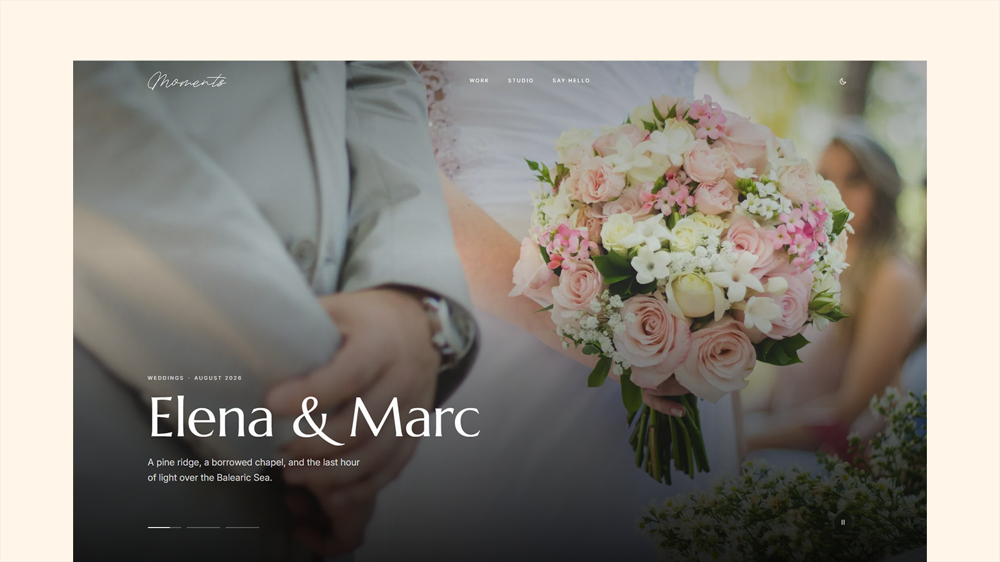

# Moments - Astro Photography Portfolio Theme

[](https://moments.xocoweb.workers.dev/)

[](https://astro.build/)
[](https://tailwindcss.com/)
[](https://mdxjs.com/)
[](https://www.typescriptlang.org/)
[](./LICENSE)

**Live preview:** https://moments.xocoweb.workers.dev/

Moments is a premium Astro theme for wedding and portrait photographers. It is built around the gallery: photographs are packed into justified rows by their own proportions, so nothing is ever cropped to fit a grid. The palette is monochrome, so the only colour on a page comes from the pictures.

## Features

- Story galleries packed into justified rows by each photograph's own proportions, so every frame fills the width at one height and nothing is cropped to fit a grid
- A masonry wall of work that keeps reading order left to right and ends every column flush, with no ragged bottom edge
- A lightbox that walks every photograph in a story, with arrows, keyboard, swipe, and a counter, built on a native `<dialog>`
- Three front-page openings from one config value: a full-bleed slideshow of featured stories, a photograph set beside the words, or none
- Two story layouts set per post: `standard` opens on the photograph at full window, `editorial` puts the title on the page for studio notes and advice pieces
- Stories as Astro content collections with validated frontmatter for title, collection, place, dates, tags, cover, layout, and featured and draft flags
- Fourteen MDX cards usable in any story with no imports: figures, galleries, pull quotes, callouts, toggles, bookmarks, audio, downloads, buttons, product cards, embeds, and signup bands
- Photographs referenced by filename from the story's own folder, so a story starts with its first sentence rather than a wall of imports
- A styleguide page showing every card, written to be copied straight out of its source
- A share sheet with the major networks, a copy-link button, and the browser's native share where available
- Paginated Work, collection, and tag pages, with collection pills doubling as the filter
- A dark studio panel whose figures are counted from your content, plus an optional collection strip and drifting band of collection names
- A testimonials slider pairing each couple's photograph with what they said
- A pricing page with three packages set in one config file
- Provider-neutral newsletter and enquiry forms
- The logo as one replaceable SVG that takes the colour of whatever it sits on
- A monochrome palette derived from a single `--brand` token, with light and dark modes and no flash on load
- Self-hosted Marcellus and Inter, with Cormorant Garamond included as a drop-in alternative
- Canonical URLs, sitemap, Open Graph and Twitter/X cards, per-story share images, and JSON-LD
- Accessible skip link, landmarks, visible focus styles, a focus-trapped drawer, and reduced-motion support

## Tech Stack

- Astro 7 with MDX
- Tailwind CSS 4
- TypeScript

## Getting Started

Requires Node.js `22.12.0` or newer.

```bash
npm install
npm run dev
```

Build for production with `npm run build`, and preview the build with `npm run preview`.

## Customization

See [CUSTOMIZATION.md](./CUSTOMIZATION.md) for site settings, the front page, stories, cards, the logo, fonts, and colours.

Stories live in [src/content/posts](./src/content/posts), one folder per story holding an `index.mdx`, a cover, and its photographs.

The demo photography is licensed for the preview only and is not included with the theme. Replace it with your own work before you publish.

## Support

See [SUPPORT.md](./SUPPORT.md) for what is included with a license.

## License

Commercial license. See [LICENSE](./LICENSE) for complete terms.
